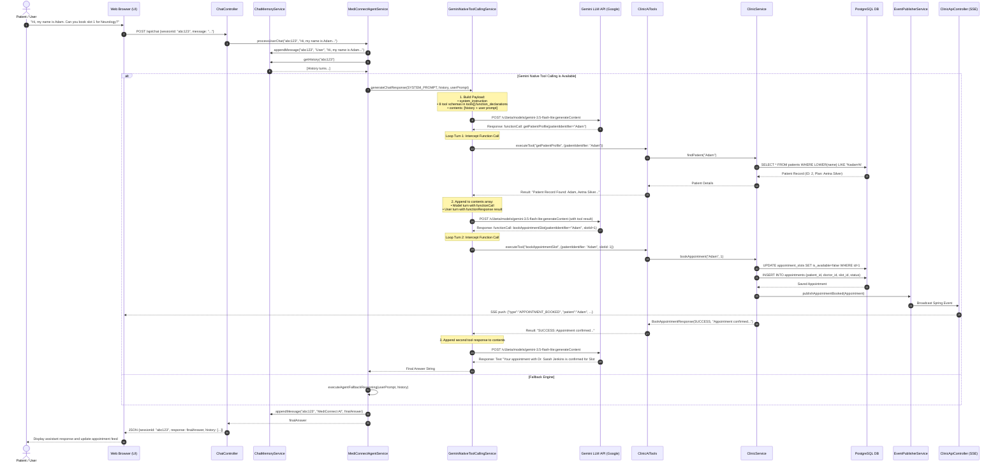
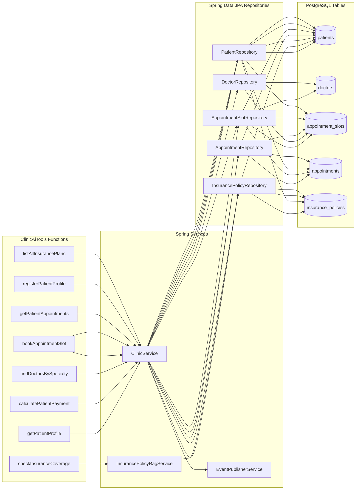
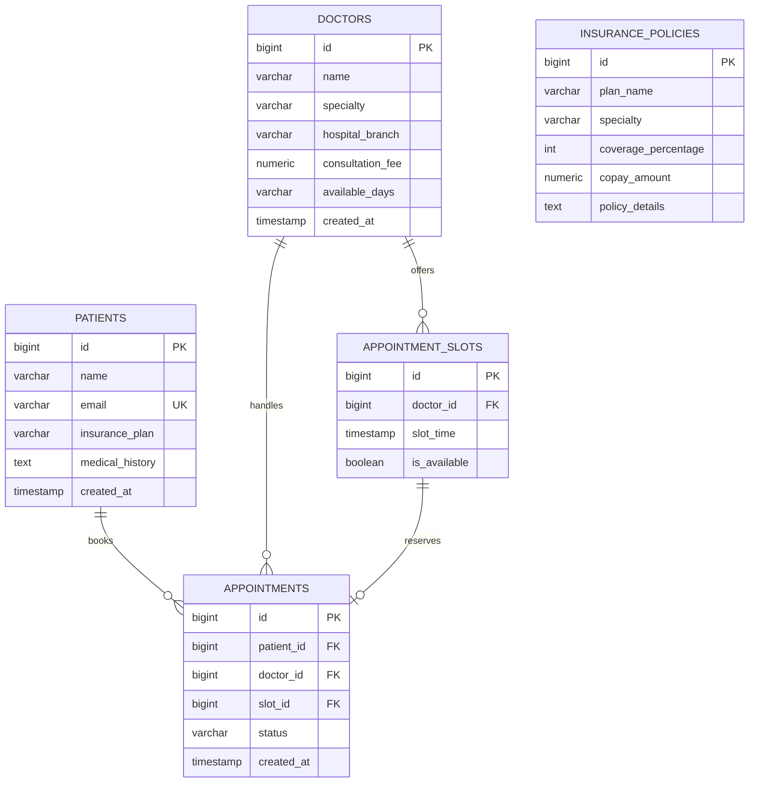
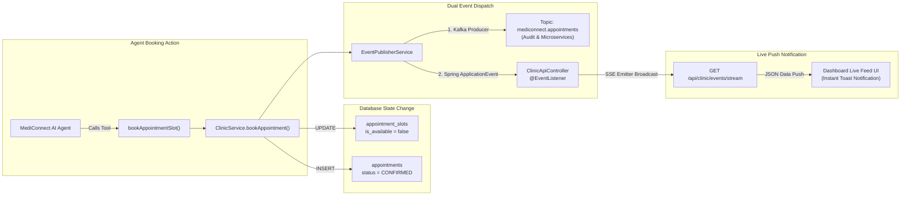

# MediConnect AI — System Architecture & Workflow Specification

This document provides a comprehensive technical breakdown of the **MediConnect AI** platform. It covers system components, end-to-end data flows, prompt embedding pipelines, autonomous multi-turn tool calling mechanisms, and fallback architectures.

---

## 1. High-Level System Architecture

The MediConnect AI ecosystem combines **Spring Boot 3.x**, **Google Gemini 3.5 / 2.5 LLM**, **PostgreSQL** for persistence, **Redis** for session chat memory, and **Kafka / Server-Sent Events (SSE)** for real-time appointment event broadcasting.

```mermaid
flowchart TB
    subgraph ClientLayer ["Client & Presentation Layer"]
        UI["Web Browser / Static UI (HTML5, JS, CSS)"]
        StreamClient["SSE Event Listener (/api/clinic/events/stream)"]
    end

    subgraph ControllerLayer ["Spring Boot REST & SSE Layer"]
        CC["ChatController\nPOST /api/chat\nGET /api/chat/history/{sessionId}"]
        CAC["ClinicApiController\nGET /api/clinic/doctors\nGET /api/clinic/appointments\nGET /api/clinic/events/stream"]
    end

    subgraph AgentLayer ["AI Agent & Reasoning Layer"]
        MAS["MediConnectAgentService\n(Orchestration & Fallback Engine)"]
        GNTS["GeminiNativeToolCallingService\n(Google Gemini REST API & Native Tool Loop)"]
        SAI["Spring AI ChatClient\n(OpenAI-Compatible Endpoint)"]
        TOOLS["ClinicAiTools\n(8 Spring @Bean Functions)"]
    end

    subgraph ServiceLayer ["Business & RAG Services"]
        CMS["ChatMemoryService\n(Session Memory with Lazy Failover)"]
        CS["ClinicService\n(Transactional Clinic Operations)"]
        RAG["InsurancePolicyRagService\n(Policy Knowledge & Coverage Search)"]
        EPS["EventPublisherService\n(Kafka & Spring Application Events)"]
    end

    subgraph PersistenceLayer ["Data & Messaging Infrastructure"]
        PG[("PostgreSQL\n(Patients, Doctors, Slots, Appointments, Insurance)")]
        REDIS[("Redis Cache\n(chat:history:{sessionId})")]
        KAFKA["Apache Kafka\n(Topic: mediconnect.appointments)"]
        GEMINI_API["Google Gemini Generative AI API\n(v1beta models/gemini-3.5-flash-lite)"]
    end

    %% Client Interactions
    UI -->|1. POST /api/chat {sessionId, message}| CC
    UI -->|GET /api/clinic/*| CAC
    StreamClient <-->|SSE Stream| CAC

    %% Controllers to Services
    CC --> MAS
    CC --> CMS
    CAC --> CS

    %% Agent Routing
    MAS -->|Fetch / Store History| CMS
    MAS -->|Primary: Native Tool Calling| GNTS
    MAS -->|Secondary: Spring AI| SAI
    MAS -->|Tertiary: Rule-Based Fallback| CS

    %% Native Tool Calling Execution
    GNTS <-->|HTTP POST Multi-Turn Chat & Tool Call| GEMINI_API
    GNTS -->|Invoke Function Beans| TOOLS

    %% Tools to Services
    TOOLS --> CS
    TOOLS --> RAG
    CS --> EPS

    %% Services to Data Store
    CMS -.->|Read / Write (24h TTL)| REDIS
    CS --> PG
    RAG --> PG
    EPS -.->|Publish Messages| KAFKA
    EPS -->|Spring ApplicationEvent| CAC
```

---

## 2. Component Inventory & Responsibilities

| Layer | Component | Source File | Responsibilities |
| :--- | :--- | :--- | :--- |
| **Presentation** | Web UI Dashboard | `resources/static/index.html` | Interactive chat UI, doctor directory, real-time live appointment feed (SSE). |
| **Controller** | `ChatController` | `controller/ChatController.java` | Receives incoming chat requests, assigns session IDs, delegates to Agent, returns reply + history. |
| **Controller** | `ClinicApiController` | `controller/ClinicApiController.java` | Exposes REST endpoints for doctors, appointments, and registers SSE emitters for real-time notifications. |
| **Agent** | `MediConnectAgentService` | `agent/MediConnectAgentService.java` | Core conversational orchestrator. Manages prompt preparation, dispatches to Gemini Native, Spring AI, or Fallback engine. |
| **Agent** | `GeminiNativeToolCallingService` | `agent/GeminiNativeToolCallingService.java` | Communicates directly with Google Gemini REST API. Implements autonomous multi-turn tool-calling loop and thought signature preservation. |
| **Agent** | `ClinicAiTools` | `agent/ClinicAiTools.java` | Defines the 8 AI-invokable function beans with structured JSON Schema metadata. |
| **Service** | `ChatMemoryService` | `service/ChatMemoryService.java` | Manages conversational history in Redis with auto-fallback to in-memory `ConcurrentHashMap`. |
| **Service** | `ClinicService` | `service/ClinicService.java` | Business logic for patient profile lookup, slot search, booking, payment & copay calculations. |
| **Service** | `InsurancePolicyRagService` | `service/InsurancePolicyRagService.java` | Policy knowledge retrieval and coverage percentage calculation. |
| **Service** | `EventPublisherService` | `service/EventPublisherService.java` | Publishes booking events to Kafka topic `mediconnect.appointments` and local Spring event bus. |

---

## 3. End-to-End API Hit & Agent Workflow

The following sequence diagram details exactly what happens from the moment a user types a message until a final response is rendered.



---

## 4. Prompt Construction & Tool Embedding Architecture

How prompt context, system instructions, and tool definitions are packaged and transmitted to Gemini:

```mermaid
graph TD
    subgraph PromptBuilder ["Prompt & Context Assembly in GeminiNativeToolCallingService"]
        SP["1. System Prompt\n(Role, Capabilities, Clinical Rules, Payment Rules)"]
        CH["2. Conversation History\n(Retrieved from Redis chat:history:{sessionId})"]
        UQ["3. Current User Query\n(Raw user input text)"]
    end

    subgraph ToolSchemas ["Registered Function Declarations (JSON Schema)"]
        T1["getPatientProfile(patientIdentifier)"]
        T2["calculatePatientPayment(patientOrPlan, specialty, fee)"]
        T3["findDoctorsBySpecialty(specialty)"]
        T4["bookAppointmentSlot(patientIdentifier, slotId)"]
        T5["checkInsuranceCoverage(planName, specialty)"]
        T6["getPatientAppointments(patientIdentifier)"]
        T7["registerPatientProfile(name, insurancePlan, email, medicalHistory)"]
        T8["listAllInsurancePlans(specialty)"]
    end

    subgraph RequestPayload ["Gemini REST API Request Body (JSON)"]
        direction TB
        JSON_SYS["'system_instruction': {\n  'parts': [{'text': SYSTEM_PROMPT}]\n}"]
        JSON_TOOLS["'tools': [{\n  'function_declarations': [8 Tool Schemas]\n}]"]
        JSON_CONTENTS["'contents': [\n  {'role': 'user', 'parts': [{'text': 'Conversation History:\n...'}]},\n  ...\n]"]
    end

    SP --> JSON_SYS
    CH & UQ --> JSON_CONTENTS
    ToolSchemas --> JSON_TOOLS

    RequestPayload -->|POST https://generativelanguage.googleapis.com/v1beta/models/{model}:generateContent?key={API_KEY}| GEMINI["Gemini LLM Engine"]
```

### Prompt & Tool Embedding Details:

1. **`system_instruction`**:
   - Explicitly instructs Gemini on its identity as MediConnect AI, lists all available tools and their usage triggers, and defines clinical safety rules (e.g., never fabricate doctor slots or insurance copays, always use tools for calculations and DB lookups).
2. **`tools.function_declarations`**:
   - Each Java tool is declared with OpenAPI/JSON Schema compatible types (`STRING`, `NUMBER`, `INTEGER`, `OBJECT`), parameter descriptions, and required fields.
3. **`contents` Multi-Turn Array**:
   - Initial User message contains full conversational history + current user query.
   - When Gemini returns a tool request, the model's exact response (including `thought_signature` and `functionCall`) is appended as a model turn.
   - The executed tool's JSON output is appended as a `user` turn containing `functionResponse`.
   - This preserved context enables Gemini to reason sequentially across up to 5 iterative tool turns.

---

## 5. Autonomous Multi-Turn Tool Calling Execution Loop

This diagram illustrates the internal execution loop within `GeminiNativeToolCallingService.java`:

```mermaid
flowchart TD
    Start([User Query Received]) --> InitPayload[Assemble system_instruction, tools schemas, and initial user contents]
    InitPayload --> LoopStart{Turn Count < 5?}
    
    LoopStart -- Yes --> SendHTTP[POST payload to Gemini generateContent]
    SendHTTP --> ParseResponse[Parse candidates[0].content]
    ParseResponse --> AppendModelTurn[Append model response to contents array]
    
    AppendModelTurn --> CheckFuncCall{Contains functionCall?}
    
    CheckFuncCall -- Yes --> ExtractArgs[Extract Function Name & JSON Arguments]
    ExtractArgs --> ExecuteJava[Dispatch to ClinicAiTools / ClinicService / RAG]
    ExecuteJava --> FormatResult[Create functionResponse JSON object]
    FormatResult --> AppendUserTurn[Append role:'user' turn with functionResponse to contents]
    AppendUserTurn --> IncrementTurn[turn++]
    IncrementTurn --> LoopStart

    CheckFuncCall -- No --> ExtractText[Extract candidates[0].content.parts.text]
    ExtractText --> ReturnFinal([Return Final Text Response to User])

    LoopStart -- No (Max Turns Reached) --> ReturnFallback([Fallback / Return null])
```

---

## 6. Available Agent Tools & Underlying Data Sources



---

## 7. Multi-Tier Resilience & Fallback Hierarchy

MediConnect AI uses a 3-tier resilient architecture to guarantee uninterrupted clinical operations:

```mermaid
flowchart TD
    Req[Incoming Chat Request] --> Tier1{Tier 1: Gemini Native Tool Calling Service<br/>Valid API Key present?}
    
    Tier1 -- Yes --> ExecTier1[Invoke GeminiNativeToolCallingService]
    ExecTier1 --> CheckSuccess1{Successful response?}
    CheckSuccess1 -- Yes --> ReturnAns1[Return LLM Response]
    CheckSuccess1 -- No (API Error / Quota Exceeded) --> Tier3
    
    Tier1 -- No --> Tier2{Tier 2: Spring AI ChatClient<br/>Configured & available?}
    Tier2 -- Yes --> ExecTier2[Invoke Spring AI ChatClient with .functions()]
    ExecTier2 --> CheckSuccess2{Successful response?}
    CheckSuccess2 -- Yes --> ReturnAns2[Return Spring AI Response]
    CheckSuccess2 -- No --> Tier3
    
    Tier2 -- No --> Tier3[Tier 3: MediConnect Rule-Based Fallback Reasoning Engine]
    Tier3 --> ExecRegex[Intent Recognition: Regex + Entity Extraction]
    ExecRegex --> ExecDirect[Direct Service Calls to ClinicService & Database]
    ExecDirect --> ReturnFallbackAns[Return Deterministic Clinical Response]
```

---

## 8. Summary of API Endpoints

### Chat Endpoints (`ChatController`)
- **`POST /api/chat`**
  - **Request Body**: `{"sessionId": "optional-uuid", "message": "user query string"}`
  - **Response Body**: `{"sessionId": "string", "response": "string", "history": ["User: ...", "MediConnect AI: ..."]}`
- **`GET /api/chat/history/{sessionId}`**
  - **Response Body**: `["User: ...", "MediConnect AI: ..."]`
- **`DELETE /api/chat/history/{sessionId}`**
  - **Response Body**: `{"status": "cleared", "sessionId": "string"}`

### Clinic & Event Endpoints (`ClinicApiController`)
- **`GET /api/clinic/doctors`**: Lists all doctors with specialties, hospital branches, and fees.
- **`GET /api/clinic/appointments`**: Lists all booked appointments.
- **`GET /api/clinic/events/stream`**: Establishes Server-Sent Events (SSE) connection to push real-time booking event streams to the dashboard.

---

## 9. Database Entity-Relationship (ER) Architecture

The relational schema in PostgreSQL manages patients, doctors, appointment slots, bookings, and insurance policies:



---

## 10. Real-Time Event & Server-Sent Events (SSE) Pipeline

When an appointment is confirmed by the AI agent, real-time UI updates occur via the following asynchronous pipeline:



