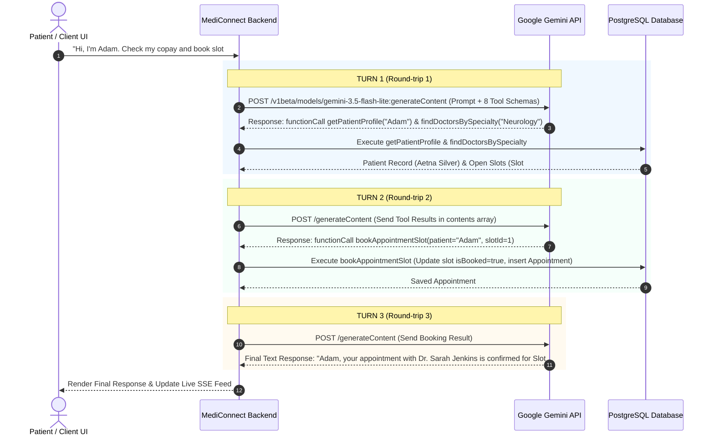

# Key Learnings & Architectural Reference

## 1. Multi-Turn Autonomous Tool Calling & Turn Limits

### Concept Overview
In LLM-based autonomous agent architectures (such as MediConnect AI's `GeminiNativeToolCallingService`), **multi-turn tool calling** allows the AI model to interact dynamically with backend database functions to satisfy complex user prompts.

---

### Key Clarifications on "Turns" vs "Tool Calls"

1. **What is a "Turn"?**
   * A **turn** is a single **HTTP round-trip exchange** between the Spring Boot application backend and the Google Gemini LLM API during a single user request.
   * **Turn Sequence:**
     * `User Prompt` $\rightarrow$ `Java Application` $\rightarrow$ `Gemini API`
     * `Gemini API` returns function call requests $\rightarrow$ `Java Application` executes tools against DB $\rightarrow$ sends results back to `Gemini API`.

2. **Parallel Tool Execution in a Single Turn:**
   * **A 5-turn limit does NOT mean the LLM is restricted to 5 tool calls.**
   * In a single turn (one HTTP response), Gemini can return **multiple parallel function calls** at once (e.g., `getPatientProfile("Adam")` AND `findDoctorsBySpecialty("Neurology")`).
   * The Java backend iterates through all `functionCall` entries in the `parts` array within that single turn:
     ```java
     for (JsonNode part : parts) {
         if (part.has("functionCall")) {
             String result = executeTool(funcName, args);
             ...
         }
     }
     ```

3. **Why the 5-Turn Limit Exists (Safety Guardrail):**
   * The `turn < 5` loop condition in [`GeminiNativeToolCallingService.java`](file:///d:/AiAgent/src/main/java/com/mediconnect/agent/GeminiNativeToolCallingService.java#L168) is an **algorithmic infinite-loop guardrail**, not a hard ceiling on tool execution.
   * **Protection:** Prevents runaway API billing or thread hanging if an LLM gets confused or loops endlessly.
   * **Real-World Reality:** Complex clinical workflows (Patient Lookup $\rightarrow$ Copay Calculation $\rightarrow$ Appointment Booking) complete in **1 to 3 turns**.
   * **Adjustable:** The limit can easily be increased (e.g., to 10 or 15 turns) by modifying the loop condition in code.

---

### Sequence & Data Flow Visualizer



---

## 2. Model Selection Evaluation: Google Gemini vs Local Ollama LLM

### Comparative Evaluation Matrix

| Technical Capability | Google Gemini (`gemini-3.5-flash-lite`) | Local Ollama (`qwen2.5:1.5b` / 3B Models) | Architectural Impact on MediConnect AI |
| :--- | :--- | :--- | :--- |
| **Structured Function Calling** | ✅ **Native JSON Schema Support:** Autonomously outputs explicit `functionCall` objects targeting registered Spring AI `@Bean` functions. | ❌ **Unreliable Tool Invocations:** Fails to format function calls cleanly; bypasses Spring AI `.functions(...)` execution handlers. | Gemini triggers actual database operations; local models bypass backend tools completely. |
| **Database Data Grounding** | ✅ **Strict DB Truth:** Uses real clinic data (*Dr. Sarah Jenkins - Neurology*, *Aetna Silver $36.00 copay*). | ❌ **High Hallucination Rate:** Fabricates non-existent doctors (*Dr. Jane Doe*) and prompts for redundant info (Date of Birth). | Gemini prevents clinical errors and guarantees real booking slot reservations. |
| **Multi-Turn Context & Reasoning** | ✅ **Thought Signature Retention:** Preserves context and tool responses across sequential round-trips without loss of state. | ❌ **Context Memory Drift:** Tends to forget prior patient turns or repeat initial questions during follow-up messages. | Gemini completes multi-step workflows (Lookup Patient $\rightarrow$ Calculate Copay $\rightarrow$ Book Slot) in 1 to 3 turns. |
| **System Event Generation** | ✅ **Live Event Triggering:** Tool execution invokes `EventPublisherService`, sending Kafka messages and pushing SSE stream events to the dashboard UI. | ❌ **No Side Effects:** Since backend functions aren't called, database tables remain unmodified and no SSE events are broadcast. | Real-time live clinic dashboard updates require functional tool execution. |

---

### Key Reasons Gemini was Selected as Primary LLM

1. **Reliable Autonomous Tool Calling:** The core architecture relies on 8 Java tool beans ([`ClinicAiTools.java`](file:///d:/AiAgent/src/main/java/com/mediconnect/agent/ClinicAiTools.java)). Gemini parses schemas and invokes tools accurately.
2. **Deterministic Financial & Clinical Accuracy:** Copay calculations and doctor slot reservations require real PostgreSQL data rather than probabilistic text generation.
3. **Multi-Tiered Fallback Architecture:** 
   * **Tier 1 (Primary):** Google Gemini Native Tool Calling Service (`gemini-3.5-flash-lite`).
   * **Tier 2 (Secondary Fallback):** Local Ollama model.
   * **Tier 3 (Tertiary Fallback):** MediConnect Rule-Based Java Specialist Multi-Agent Engine (`BookingAgent` & `InsurancePolicyRagAgent`).

